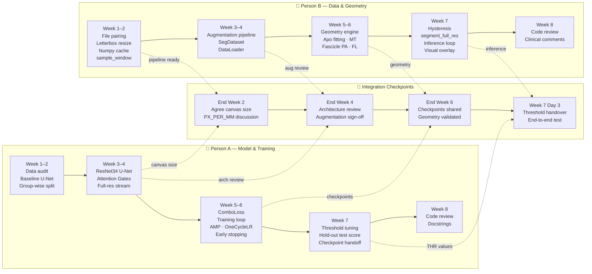

# Diagram 8 — Work Division & Timeline

---

# Diagram 9 — Module Ownership Map

```mermaid
flowchart TD
    NB["colab_muscle_segmentation_IMPROVED2.ipynb"]

    NB --> S1["§1 Setup\nImports · CFG · Device · Seed"]
    NB --> S2["§2 Data — Drive mount\nDataset discovery · ZIP extract"]
    NB --> S3["§3 Data Audit\nPair matching · Stroke width · Overlays"]
    NB --> S4["§4 Group Split\nSubject-aware train/val/test"]
    NB --> S5["§5 Canvas · Cache · Augmentation\nLetterbox · prep_mask · SegDataset · DataLoader"]
    NB --> S6["§6 Model · Loss · Metrics\nResNet34 U-Net · ComboLoss · Dice · tolF1"]
    NB --> S7["§7 Training\nLoop · AMP · Scheduler · Early stop"]
    NB --> S8["§8 Threshold Tuning\nVal sweep · Hold-out test score"]
    NB --> S9["§9 Geometry Engine\nApo fitting · MT · PA · FL"]
    NB --> S10["§10 Inference\nHysteresis · Full-res seg · NaN fill"]
    NB --> S11["§11 Visual Check\nColour overlays · Fitted lines"]

    style S1 fill:#1e2433,stroke:#475569,color:#94a3b8
    style S2 fill:#1a2f50,stroke:#3b82f6,color:#93c5fd
    style S3 fill:#1a2f50,stroke:#3b82f6,color:#93c5fd
    style S4 fill:#1a2f50,stroke:#3b82f6,color:#93c5fd
    style S5 fill:#14532d,stroke:#22c55e,color:#bbf7d0
    style S6 fill:#1a2f50,stroke:#3b82f6,color:#93c5fd
    style S7 fill:#1a2f50,stroke:#3b82f6,color:#93c5fd
    style S8 fill:#1a2f50,stroke:#3b82f6,color:#93c5fd
    style S9 fill:#14532d,stroke:#22c55e,color:#bbf7d0
    style S10 fill:#14532d,stroke:#22c55e,color:#bbf7d0
    style S11 fill:#14532d,stroke:#22c55e,color:#bbf7d0
```

> **Blue sections** → owned by Person A (Model & Training)  
> **Green sections** → owned by Person B (Data & Geometry)
